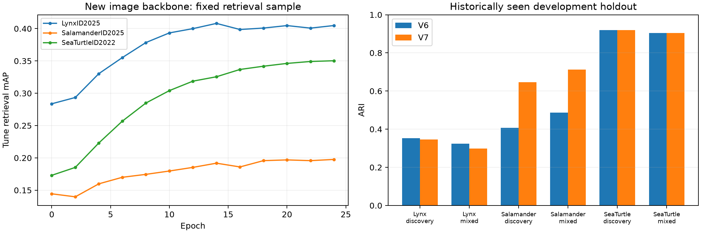

# V7 图像级与对应匹配实验报告

开发留出六项平均 ARI：V3 **0.559335** → V6 **0.565657** → V7 **0.637717**。V7 比 V6 变化 **+0.072060**（ARI ×100 后 +7.206 个点，相对 +12.74%）。

这是历史上已查看的开发留出集结果，不是全新独立测试，也不是 Kaggle 分数。新方案尚无官方成绩。没有用 audit 结果重新选择本轮配置。

| 物种 | 模式 | V6 ARI | V7 ARI | 变化 |
|---|---|---:|---:|---:|
| 猞猁 | discovery | 0.353430 | 0.345249 | -0.008181 |
| 猞猁 | mixed | 0.323265 | 0.297932 | -0.025333 |
| 蝾螈 | discovery | 0.406374 | 0.646202 | +0.239828 |
| 蝾螈 | mixed | 0.486716 | 0.712761 | +0.226045 |
| 海龟 | discovery | 0.919415 | 0.919415 | +0.000000 |
| 海龟 | mixed | 0.904744 | 0.904744 | +0.000000 |

## 最终采用的分支

| 物种 | 固定配置 | tune 平均 ARI：V6 → V7 |
|---|---|---:|
| 猞猁 | trained，新分数权重 0.25，leiden，阈值 0.300 | 0.569729 → 0.604589 |
| 蝾螈 | spot_1，新分数权重 0.50，leiden，阈值 0.350 | 0.557357 → 0.727671 |
| 海龟 | 保持 V6 | 0.906206 → 0.906206 |

### 蝾螈主要分支对照（同一 tune 搜索）

| 分支 | 最佳 tune 平均 ARI |
|---|---:|
| 训练后图像表示（校准） | 0.534712 |
| 未训练图像表示（余弦） | 0.576961 |
| 局部斑纹对应 | 0.727671 |
| RoMa 稠密对应 | 0.583101 |
| 斑纹与 RoMa 组合 | 0.725477 |

这是调参候选的最佳值，不是额外独立测试。RoMa 已完成计划的校准与调参匹配，未因架构更新而强行加入最终方案。

各分支名称：`trained` 是按身份训练的 DINOv3-L 联合表示并校准；`initial` 是同输入和池化的未训练对照；`_raw` 使用原始余弦相似度；`spot_*` 是局部高置信度对应或几何内点；`roma*` 是候选上的双向稠密匹配；`base` 是 V6 分数。训练过或使用更新模型并不保证进入最终方案。

## 新图像模型训练证据

| 物种 | 同一采样检索集：初始 mAP | 最佳 mAP |
|---|---:|---:|
| 猞猁 | 0.283717 | 0.408075 |
| 蝾螈 | 0.144416 | 0.197606 |
| 海龟 | 0.173032 | 0.350310 |

以上 mAP 只比较同一新骨干的训练前后，不能与整套 V3/V6 的 ARI 直接比较。24 个 epoch、1,920 次优化，2,131,969 个可训练参数，实际使用 RTX 5060 Ti。训练集和分数校准集均与 tune/audit 按身份隔离。

## 误合并与漏匹配

| 物种/模式 | V6→V7 成对精确率 | V6→V7 成对召回率 | 错误合并对数 V6→V7 |
|---|---:|---:|---:|
| 猞猁/discovery | 0.8391 → 0.7226 | 0.2365 → 0.2426 | 37 → 76 |
| 猞猁/mixed | 0.6800 → 0.4794 | 0.2297 → 0.2471 | 56 → 139 |
| 蝾螈/discovery | 0.9930 → 0.9414 | 0.2572 → 0.4946 | 1 → 17 |
| 蝾螈/mixed | 0.9884 → 0.9494 | 0.3244 → 0.5725 | 1 → 8 |
| 海龟/discovery | 0.9658 → 0.9658 | 0.8786 → 0.8786 | 154 → 154 |
| 海龟/mixed | 0.9089 → 0.9089 | 0.9024 → 0.9024 | 264 → 264 |

### 不同已知视角的同身份图片对

| 物种/模式 | 同身份跨视角对数 | V6→V7 召回率 |
|---|---:|---:|
| 猞猁/discovery | 471 | 0.0637 → 0.0679 |
| 猞猁/mixed | 280 | 0.0536 → 0.0964 |
| 蝾螈/discovery | 284 | 0.0070 → 0.0704 |
| 蝾螈/mixed | 120 | 0.0167 → 0.1167 |
| 海龟/discovery | 3576 | 0.8817 → 0.8817 |
| 海龟/mixed | 2070 | 0.9053 → 0.9053 |

## 验证与局限

- 已独立重放 V6 开发留出和测试分组，重放 V7 tune 结果；锁定输入的哈希与匹配证据保持一致。
- 局部匹配使用真实特征点，完整精度的批量/逐对检查通过。早期半精度匹配因一致性问题被隔离，未用于最终匹配分数。RoMa 的训练侧候选名单保留了初始筛选，以避免中途改变样本。
- 提交文件包含 2,409 行，顺序、唯一性、完整性、物种隔离均通过检查；未替换分支和蜥蜴的行保持 V6 原样。
- 六次身份子集检验都是 tune 上的稳定性检查，不是六个独立外部数据集。反复使用历史开发集可能高估泛化提升。
- RoMa 是稀疏候选验证；局部参考图库只比较基线前 32 张。候选外的配对仍可能遗漏。公开预训练权重的来源和数据覆盖遵循原模型说明，本实验没有证明其训练数据与比赛完全无重合。

## 交付

- `submission.csv`：本轮锁定方案的正式格式文件，尚未提交 Kaggle。
- `audit_report.json`、`audit_predictions.csv`：开发指标和逐图预测。
- `selected_config.json`、`frozen.json`、`verification.json`：选择、输入和核验记录。
- `tune_search.json`、训练日志、checkpoint、校准器和代码：实验依据。
- 完整数据、原始大模型权重、全部特征与匹配缓存保留在工作区，精简交付包不重复装入这些大文件。

提交 SHA-256：`61a1221a81f4248a2e9e167e5547135052bf1f3ca8084dcdca5515dcd431a551`。

公开方法来源与本轮独立改动见交付包根目录 `RESEARCH.md`；完整流程见 `README.md`。
